# BÁO CÁO 00: TỔNG QUAN SẢN PHẨM VÀ NỀN TẢNG CÔNG NGHỆ CAPCUT 19.4.0

> **Mục tiêu đáp ứng**: Yêu cầu 1 (Decompile phân tích code đối thủ) & Yêu cầu 2 (Công nghệ/nền tảng phát triển áp dụng, điểm khác biệt, đặc biệt).  
> **Phiên bản phân tích**: CapCut Video Editor v19.4.0 (Build 19400300) — Package `com.lemon.lvoverseas`.  
> **Dung lượng APK**: 316,100,601 bytes (~316 MB) | 39 tập tin DEX (38 dex chính + 1 audience network dex) | 315,227 classes | 337 thư viện Native (.so).

---

## 1. TỔNG QUAN SẢN PHẨM & CẤU TRÚC PHÁT HÀNH

CapCut Global (`com.lemon.lvoverseas`) là phiên bản quốc tế của JianYing (剪映 - ByteDance). Ứng dụng được đóng gói dưới dạng **Android App Bundle (AAB) fused APK**, chia nhỏ thành các Dynamic Feature Modules độc lập:

| Tên Module Fused | Mã DEX đại diện | Chức năng chính |
|---|---|---|
| `base` | `classes.dex` -> `classes28.dex` | Nhân ứng dụng, Framework Vega, Launcher, Koin DI, UI Core |
| `df_commerce` | `classes29.dex` | Thanh toán, VIP Subscription, Paywall, Google Play Billing 8.2.1 |
| `df_template` | `classes30.dex` | Hệ sinh thái Mẫu (Templates), Feed khám phá, Lynx Dynamic View |
| `df_ship1` | `classes35.dex` | Gói phân phối tính năng bổ trợ 1 (Assets, Stickers) |
| `df_ship2` | `classes36.dex` | Gói phân phối tính năng bổ trợ 2 (Filters, Effects, Audio) |
| `df_ship3` | `classes31.dex` | Gói phân phối tính năng bổ trợ 3 (Social integration, TikTok link) |
| `df_ship4` | `classes32.dex` | Gói phân phối tính năng bổ trợ 4 (Export pipeline) |
| `df_resources` | `classes33.dex` | Quản lý tải tài nguyên hiệu ứng, phông chữ, mẫu động từ CDN |
| `df_common` | `classes34.dex` | Tiện ích dùng chung, File IO, Image loading Fresco/Glide |
| `df_pitaya` | `classes37.dex` | **ByteDance Pitaya** — Nền tảng On-Device AI & Decision Engine |
| `df_edit` | `classes38.dex` | Nhân biên tập video chính, Track Timeline, Keyframe, Video Engine |

---

## 2. NỀN TẢNG CÔNG NGHỆ CỐT LÕI (CORE TECH STACK)

CapCut không phải là một ứng dụng Android thuần túy thông thường mà là một **siêu nền tảng đa tầng (Hybrid Multi-Tier Platform)** kết hợp giữa Java/Kotlin, C++ Native Engine, Kotlin Multiplatform (KMP), ByteDance Lynx, và Yoga Flexbox Engine.

```mermaid
graph TD
    UI[Tầng Giao Diện Người Dùng] --> Compose[Jetpack Compose Multiplatform]
    UI --> Lynx[ByteDance Lynx Native Rendering]
    UI --> Loom[ByteDance Loom UI / Yoga Flexbox]
    
    Biz[Tầng Nghiệp Vụ & Logic] --> KMP[Kotlin Multiplatform KMP Agent Core]
    Biz --> Koin[Koin Dependency Injection]
    Biz --> Vega[Vega Framework Architecture]
    
    Middle[Tầng Cầu Nối Middle-Bridge] --> JNI[JNI Middle-Bridge Layer]
    Middle --> MiddleSo[libmiddle-bridge.so ~60.7 MB]
    
    Native[Tầng Đồ Họa & Đa Phương Tiện C++] --> VE[ByteDance Video Engine libcccreator.so]
    Native --> FFmpeg[Custom FFmpeg Fork libttffmpeg.so]
    Native --> AudioDSP[ByteDance Audio DSP libaudioeffect.so]
    Native --> Pitaya[On-Device AI libAndroidPitayaCore.so]
    Native --> TTNet[ByteDance Cronet / QUIC libsscronet.so]
```

### 2.1. Tầng Giao Diện Đa Nền Tảng (Hybrid UI Engine)
1. **Jetpack Compose Multiplatform**: Các màn hình phức tạp mới nhất như `ComposeSubscribeActivity` (Payment Wall VIP) và các cụm giao diện chọn mẫu được viết bằng Jetpack Compose với kiến trúc Reactive State.
2. **ByteDance Loom (`com.vega.loom`)**: Bộ engine layout siêu nhẹ của riêng ByteDance dựa trên Facebook Yoga C++ Flexbox, cho phép tính toán layout linh hoạt ngoài main thread, render stylesheet động và chạy các biểu thức toán học thời gian thực (`com.vega.loom.expression`).
3. **ByteDance Lynx (`com.vega.lynx`)**: Nền tảng render native tương tự React Native nhưng do ByteDance tự tối ưu C++, cho phép tải giao diện động từ server (`assets/offline/*`, `template.js`) không cần update app.

### 2.2. Tầng Nghiệp Vụ KMP (Kotlin Multiplatform)
CapCut áp dụng **Kotlin Multiplatform (KMP)** cho toàn bộ lõi AI Agent (`com.vega.kmp.agent.core`):
- Lớp quản lý hội thoại (`Conversation`, `ConversationRepo`).
- Giao thức nhắn tin luồng SSE (`DefaultAgentMessagingProtocol`, `SseConnection`).
- Kiến trúc gọi công cụ AI chuẩn MCP (`com.vega.kmp.agent.core.tools.mcp`).
- Cho phép chia sẻ 100% mã nguồn logic AI giữa Android, iOS, Windows PC và MacOS.

### 2.3. Tầng Đa Phương Tiện & Đồ Họa C++ Native (Engine Layer)
Chiếm hơn 65% dung lượng APK với 337 thư viện `.so`:
1. **`libmiddle-bridge.so` (60.7 MB)**: Tầng C++ trung gian kết nối mọi lệnh từ UI Java/Kotlin xuống Video Engine. Quản lý timeline, track, cut, transition, render pipeline.
2. **`libcccreator.so` (40.1 MB)**: Engine dựng hình CapCut Creator, xử lý composition, rendering, encoding và effect graph.
3. **`libmiddleware.so` (24.9 MB)**: Xử lý phần cứng, decode phần cứng MediaCodec, GPU EGL Context, Vulkan/OpenGL ES 3.0 shaders.
4. **`libttffmpeg.so` (5.7 MB)**: Bản fork FFmpeg được ByteDance tinh chỉnh tối đa cho streaming, fast-seek theo từng frame, muxer/demuxer tối ưu cho định dạng MP4/H.264/H.265/AV1.
5. **`libaudioeffect.so` (5.0 MB)**: Bộ xử lý âm thanh số (DSP): lọc tạp âm, thay đổi cao độ giọng nói (Voice Changer), phân tích nhịp điệu (Beat Detection), tách lời bài hát (Vocal Separation).

### 2.4. Mạng & Giao Thức Truyền Dẫn ByteDance TTNet
- Sử dụng Chromium Cronet tùy biến (`libsscronet.so`).
- Hỗ trợ giao thức **QUIC (HTTP/3)** kết hợp HTTP/2 multiplexing.
- Cơ chế **TNC (Traffic Network Control)**: tự động phân giải domain tối ưu theo từng nhà mạng và vị trí địa lý, tự động failover IP khi domain bị chặn.
- Chữ ký bảo mật native: Tự động mã hóa và chèn các header chống cào dữ liệu (`X-Gorgon`, `X-Khronos`, `X-Argus`, `X-Ladon`) từ tầng C++.

---

## 3. ĐIỂM KHÁC BIỆT & ĐẶC BIỆT SO VỚI ĐỐI THỦ

1. **Kiến trúc Middle-Bridge C++ Thống Nhất Đa Nền Tảng**:
   Khác với các app video thông thường viết logic chỉnh sửa bằng Java/Kotlin trên Android và Swift trên iOS, CapCut đưa toàn bộ logic chỉnh sửa, track management và effect tree vào `libmiddle-bridge.so` viết bằng C++20. Nhờ đó, trải nghiệm chỉnh sửa trên Android, iOS, Web và Desktop (PC/Mac) hoàn toàn đồng nhất 100%.

2. **Hệ Thống AI Agent Thế Hệ Mới với MCP (Model Context Protocol)**:
   Tích hợp trực tiếp chuẩn giao tiếp AI Agent mã nguồn mở MCP (`com.vega.kmp.agent.core.tools.mcp`), biến CapCut thành một AI Copilot thông minh. Người dùng chỉ cần gõ yêu cầu văn bản hoặc nói qua giọng nói, Agent sẽ tự động phân tích kịch bản, gọi công cụ MCP tương ứng trên máy (crop, cut, thêm text, tạo phụ đề tự động) hoặc trên đám mây.

3. **Truyền Dữ Liệu Luồng Phản Hồi Trực Tuyến (Server-Sent Events - SSE Stream)**:
   Thay vì REST API request-response truyền thống gây độ trễ lớn, hệ thống AI Chat và Video Generator kết nối trực tiếp qua SSE Stream dài hạn với cơ chế Watchdog tự phục hồi kết nối ngắt quãng (`SseWatchdogConfig`, `AiLabHostSseTransport`).

4. **Hạ Tầng Tải Tài Nguyên Động Siêu Tốc (Gecko Resource Engine)**:
   Dung lượng các bộ lọc, font chữ, hiệu ứng không bị nhúng cứng trong APK mà được đóng gói thành các gói Gecko diff-patch. Chỉ khi người dùng nhấn vào effect, Gecko mới kéo gói delta siêu nhẹ từ CDN đa vùng (`sf16-effect-capcut.byteeffecttos-g.com`).

5. **Chiến Lược Giữ Chân Người Dùng Mua Hàng Đa Tầng (Detain Retain Strategy)**:
   Hệ thống Paywall kiểm soát bằng `DetainStrategy` và `VisitorAutoRenewExperiment`. Khi người dùng có ý định tắt popup mua Pro, hệ thống kích hoạt màn hình giữ chân cấp 1 (`FirstDetainModalCfg`) giảm giá 20%, nếu tiếp tục từ chối sẽ kích hoạt cấp 2 (`SecondDetainModalCfg`) tặng thêm ngày dùng thử miễn phí hoặc gói tuần giá rẻ.
