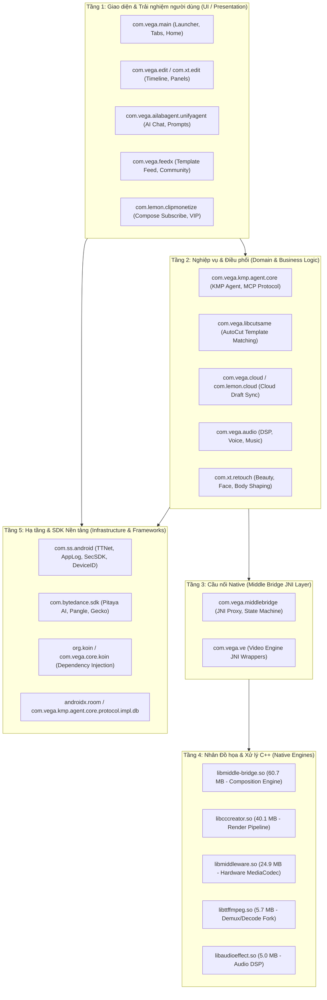

# BÁO CÁO 01: CẤU TRÚC THƯ MỤC MÃ NGUỒN VÀ CHỨC NĂNG TỪNG PHÂN HỆ

> **Mục tiêu đáp ứng**: Yêu cầu 9 (Vẽ cấu trúc thư mục Code : chức năng nhiệm vụ từng thư mục).  
> **Tổng số lớp đã bóc tách**: 315,227 classes trên 38 tập tin DEX chính.  
> **Kiến trúc chủ đạo**: Vega Enterprise Architecture + Clean Architecture + Kotlin Multiplatform (KMP) + JNI C++ Middle-Bridge.

---

## 1. SƠ ĐỒ CẤU TRÚC PHÂN TẦNG TỔNG THỂ (LAYERED ARCHITECTURE)

Mã nguồn CapCut được chia thành 5 phân tầng rõ rệt, bảo đảm tính độc lập giữa giao diện người dùng, nghiệp vụ AI/biên tập, và nhân đồ họa C++:

---

## 2. BẢNG CHI TIẾT CÁC GÓI MÃ NGUỒN CHỦ ĐẠO

| Gói Mã Nguồn (Package) | Số lượng Classes | Phân hệ chức năng | Nhiệm vụ chính & Các thành phần trọng yếu |
|---|---|---|---|
| `com.vega.edit` | 30,060 | Lõi Biên Tập Video | Điều phối Timeline nhiều track (video, audio, text, sticker, overlay, PIP). Quản lý Keyframe, hiệu ứng chuyển cảnh (transitions), mặt nạ (masks), tốc độ (curve speed). Chứa các Activity chỉnh sửa chính: `VideoCaptureEditActivity`, `VideoEditActivity`. |
| `com.xt.retouch` | 20,870 | Làm Đẹp & Retouch (Xingtu) | Tích hợp nhân chỉnh sửa chân dung chuyên sâu từ ứng dụng Xingtu (醒图 / Hypic): nhận diện khuôn mặt 3D, làm mịn da, trang điểm AI, nắn bóp gương mặt và vóc dáng, làm trắng răng, xóa khuyết điểm. |
| `com.vega.middlebridge` | 14,643 | Cầu Nối C++ Middle Bridge | Chuyển đổi toàn bộ trạng thái UI sang cấu trúc dữ liệu C++ tương ứng trong `libmiddle-bridge.so`. Quản lý luồng gọi hàm Native thông qua JNI, đồng bộ Timeline không độ trễ. |
| `com.vega.feedx` | 9,066 | Mạng Xã Hội Mẫu & Feed | Cung cấp nguồn cấp dữ liệu video mẫu (Template Feed), quản lý trang Creator, hệ thống bình luận, thích, chia sẻ và theo dõi. Hỗ trợ hiển thị động bằng Lynx Dynamic Templates. |
| `com.vega.audio` | 7,062 | Xử Lý m Thanh | Chỉnh sửa âm thanh, nhận diện nhịp phách tự động (Beat Detection), tách giọng hát khỏi nhạc nền (Vocal Removal), hiệu ứng giọng nói (Voice Effects), kho nhạc nền bản quyền. |
| `com.ss.android` | 6,045 | ByteDance Base SDKs | Nền tảng vi dịch vụ của ByteDance: TTNet (mạng QUIC/HTTP2), AppLog (ghi nhận hành vi telemetry), SecSDK (chống gian lận, sinh chữ ký `X-Gorgon`/`X-Khronos`), Account/Passport login. |
| `com.vega.cutsameedit` & `com.vega.libcutsame` | 9,894 | Mẫu Một Chạm (CutSame/AutoCut) | Công nghệ "Cắt Tương Tự" (CutSame). Tự động phân tích video người dùng tải lên, cắt khớp theo phách nhạc của mẫu mẫu, tự động chèn hiệu ứng và chuyển cảnh khớp 100% với video mẫu. |
| `com.bytedance.sdk` | 5,731 | SDK Bổ Trợ ByteDance | Bao gồm Pangle Ad SDK (quảng cáo kiếm tiền), Pitaya (ML runtime trên thiết bị), Gecko (tải tài nguyên động), Slardar (giám sát crash và hiệu năng). |
| `com.vega.libsticker` | 5,326 | Nhãn Dán & Văn Bản Động | Quản lý kho nhãn dán, chữ nghệ thuật (Text Animations), hiệu ứng phụ đề tự động (Auto-captions), nhận diện tiếng nói và tạo karaoke timing. |
| `com.vega.image` & `com.xt.edit` | 9,644 | Chỉnh Sửa Hình Ảnh & Đồ Họa | Trình biên tập hình ảnh tĩnh, xóa nền thông minh (AI Cutout), làm nét ảnh AI (AI Image Enhancer), mở rộng khung hình AI (AI Expand). |
| `com.vega.adeditor` | 4,788 | Trình Tạo Video Quảng Cáo | Công cụ chuyên biệt cho người bán hàng TikTok Shop và nhà quảng cáo: tạo video quảng cáo tự động từ link sản phẩm, kịch bản bán hàng AI. |
| `com.vega.gallery` | 4,070 | Media Picker & Quản Lý Album | Trình chọn ảnh và video tùy biến cao cấp, hỗ trợ preview nhanh, phân loại video/ảnh/LivePhoto, phân tích thông minh các đoạn clip đẹp nhất. |
| `com.lemon.clipmonetize` & `com.vega.subscription` | 5,708 | Doanh Thu, VIP & Paywall | Xử lý toàn bộ logic gói đăng ký CapCut Pro / VIP, thanh toán Google Play Billing 8.2.1, quản lý chiến lược giữ chân người dùng (`DetainStrategy`), voucher giảm giá, hiển thị Compose Subscribe Screen. |
| `com.vega.main` | 3,556 | Điều Hướng Chính & Launcher | Màn hình chính `MainActivity`, thanh điều hướng dưới đáy (Bottom Navigation Tab Bar: Edit, Template, AI Lab, Toolbox, Inbox, Me), quản lý danh sách Project dự án cục bộ, Splash Screen, Bootstrap. |
| `com.vega.ailabagent` & `com.vega.aivideoagent` | 4,200+ | Hệ Thống AI Agent (Edward) | Trí tuệ nhân tạo Agentic Workflow của CapCut: Trò chuyện AI, kịch bản sang video (Script to Video), sinh ảnh AI, hỗ trợ Model Context Protocol (MCP) gọi tool tự động, luồng SSE stream. |
| `com.vega.cloud` & `com.lemon.cloud` | 3,200+ | Lưu Trữ & Đồng Bộ Đám Mây | Không gian đám mây CapCut Cloud Space, sao lưu bản nháp dự án (Cloud Draft Backup), chia sẻ bản nháp qua link cho nhóm làm việc (Team Collaboration). |
| `com.vega.export` & `com.vega.publish` | 4,858 | Xuất Bản & Render Video | Mã hóa video đầu ra (H.264, HEVC/H.265, AV1), thiết lập độ phân giải (720p, 1080p, 2K, 4K), tỷ lệ khung hình (24fps, 30fps, 50fps, 60fps), xuất trực tiếp sang TikTok, Instagram, YouTube. |
| `com.vega.kmp.agent.core` | 650+ | Nhân AI Kotlin Multiplatform | Lõi Agent độc lập nền tảng: quản lý session chat, Room Database lưu lịch sử tin nhắn, cơ chế tự động kết nối lại SSE, phân phối công cụ MCP. |
| `com.vega.loom` | 450+ | Giao Diện Động Flexbox (Loom) | Bộ engine hiển thị giao diện động dựa trên Facebook Yoga, hỗ trợ parse stylesheet, chạy biểu thức động không cần build lại APK. |
| `com.vega.recorder` | 2,203 | Quay Video & Máy Ảnh | Máy ảnh tích hợp trong app: tính năng máy nhắc chữ (Teleprompter), bộ lọc làm đẹp thời gian thực khi quay, quay màn hình kèm PIP (Picture-in-Picture). |

---

## 3. CẤU TRÚC CHI TIẾT TỪNG PHÂN HỆ TRỌNG T M

### 3.1. Phân hệ Biên tập (`com.vega.edit.*`)
- `com.vega.edit.video`: Các lớp quản lý phiên chỉnh sửa video chính (`VideoEditActivity`).
- `com.vega.edit.timeline`: Lớp quản lý giao diện dòng thời gian, cuộn phóng to thu nhỏ track, bắt dính nam châm (magnetic snapping).
- `com.vega.edit.base.algorithm`: Tích hợp các thuật toán thị giác máy tính: theo dõi chuyển động (Motion Tracking), ổn định hình ảnh (Stabilization), làm mịn chuyển động (Optical Flow Slow Motion).
- `com.vega.edit.cover`: Chọn và thiết kế ảnh bìa video clip.

### 3.2. Phân hệ AI Agent (`com.vega.ailabagent.*` & `com.vega.kmp.agent.core.*`)
- `com.vega.ailabagent.unifyagent`: Giao diện chat AI thống nhất (`AiLabAgentChatActivity`).
- `com.vega.ailabagent.unifyagent.conversation.sse`: Tầng vận chuyển luồng SSE (`AiLabHostSseTransport`, `AiLabHostSseApiService`).
- `com.vega.kmp.agent.core.tools.mcp`: Triển khai chuẩn **Model Context Protocol (MCP)** với các lớp:
  - `ToolDefine`: Định nghĩa schema tham số của từng công cụ mà AI có thể gọi.
  - `ToolServer`: Quản lý danh mục các tool có sẵn trên máy và trên cloud.
  - `ToolDispatcher`: Thực thi tool khi model LLM trả về lệnh gọi hàm (`ToolCallMessage`).
  - `ToolRetryStrategy`: Tự động thử lại khi tool bị lỗi.

### 3.3. Phân hệ Thương mại & Thanh toán (`com.lemon.clipmonetize.*`)
- `com.lemon.clipmonetize.biz.commerce_page.lv_oversea`: Toàn bộ logic giao diện mua hàng CapCut Pro.
- `com.lemon.clipmonetize.biz.payment.impl`: Bộ điều phối cổng thanh toán Google Play Billing Client 8.2.1 và web checkout.
- `com.lemon.clipmonetize.biz.commerce_page.lv_oversea.purchase.failure`: Chuỗi xử lý lỗi thanh toán (`FailureHandlerChainKt`), hỗ trợ phục hồi gói đăng ký chéo hệ điều hành (Cross-OS restore).
