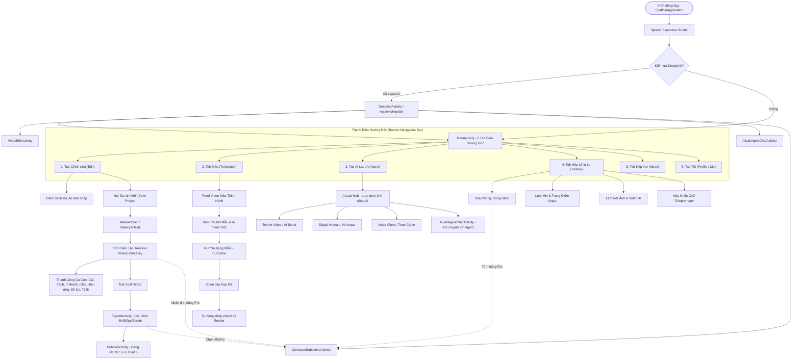

# BÁO CÁO 02: CẤU TRÚC ĐIỀU HƯỚNG, MENU/TAB VÀ DANH MỤC MÀN HÌNH CAPCUT 19.4.0

> **Mục tiêu đáp ứng**: Yêu cầu 15 (Cấu trúc Flow màn hình), Yêu cầu 16 (Danh sách menu/tab từ cha xuống con), Yêu cầu 17 (Danh sách màn hình, nội dung, chức năng, cấu trúc, xuất XML/HTML, báo cáo dạng bảng).  
> **Tổng số màn hình (Activities) bóc tách**: 485 Activities từ `AndroidManifest.xml`.  
> **Dữ liệu thô xuất kèm**: `Report/data/screens_structure.xml` & `Report/data/screens_structure.html`.

---

## 1. SƠ ĐỒ LUỒNG ĐIỀU HƯỚNG MÀN HÌNH (APPLICATION NAVIGATION FLOW)



---

## 2. DANH SÁCH MENU, TAB VÀ CẤU TRÚC PHÂN CẤP (CHA - CON)

Hệ thống menu được tổ chức theo mô hình cây phân cấp rõ ràng từ màn hình gốc xuống các bảng điều khiển (tool panels) chuyên sâu:

```
├── [GỐC] MainActivity (Bottom Tab Navigation)
│   ├── [TAB 1] CHỈNH SỬA (EDIT / HOME)
│   │   ├── Banner Thông Báo & Khuyến Mãi Pro
│   │   ├── Lối Tắt Nhanh (Quick Action Grid):
│   │   │   ├── Xóa nền ảnh/video (Cutout)
│   │   │   ├── Nâng cao chất lượng hình ảnh (AI Enhancer)
│   │   │   ├── Tạo phụ đề tự động (Auto Captions)
│   │   │   ├── Chỉnh sửa hàng loạt (Batch Edit)
│   │   │   └── Máy nhắc chữ khi quay (Teleprompter)
│   │   ├── Nút Trung Tâm: "Dự Án Mới" (New Project) -> Mở MediaPicker
│   │   └── Danh Sách Dự Án (Projects Workspace):
│   │       ├── Thẻ Dự Án Cục Bộ (Local Drafts)
│   │       ├── Thẻ Không Gian Đám Mây (Cloud Space Backup)
│   │       └── Menu Ba Chấm Trên Dự Án (Đổi tên, Nhân bản, Tải lên Cloud, Xóa)
│   │
│   ├── [TAB 2] MẪU (TEMPLATES / FEED)
│   │   ├── Thanh Tìm Kiếm Mẫu & Thẻ Xu Hướng (Trending Tags)
│   │   ├── Danh Mục Mẫu (Tabs Con: Dành cho bạn, Meme, Nhịp điệu, Tình yêu, Vlog, TikTok Trends)
│   │   ├── Thẻ Mẫu Video (Template Cards): Tác giả, Lượt sử dụng, Xem trước video
│   │   └── Nút "Sử Dụng Mẫu" -> Mở luồng CutSame thay thế clip
│   │
│   ├── [TAB 3] AI LAB (SÁNG TẠO AI)
│   │   ├── Khung Chat Tương Tác AI Copilot (AiLabAgentChatActivity)
│   │   ├── Phân Hệ Trí Tuệ Nhân Tạo Con:
│   │   │   ├── Kịch bản thành video (Script to Video)
│   │   │   ├── Người kỹ thuật số / Avatar ảo (Digital Human)
│   │   │   ├── Tạo ảnh nghệ thuật AI (AI Image Generator)
│   │   │   └── Nhân bản giọng nói (Tone Clone Voice)
│   │   └── Lịch Sử Phiên AI & Hạn Mức Tín Dụng Miễn Phí (Free Credits Counter)
│   │
│   ├── [TAB 4] HỘP CÔNG CỤ (TOOLBOX / PROPERTY)
│   │   ├── Nhóm Công Cụ Video (Làm mượt chuyển động, Ổn định chống rung, Tách tiếng)
│   │   ├── Nhóm Công Cụ Chân Dung (Gọt mặt, Làm mịn da, Trang điểm, Nâng mũi, Trắng răng)
│   │   └── Quản Lý Tài Sản (Phông chữ đã tải, m thanh lưu trữ, Hiệu ứng yêu thích)
│   │
│   ├── [TAB 5] HỘP THƯ (INBOX / MESSAGES)
│   │   ├── Thông Báo Hệ Thống (System Notifications)
│   │   ├── Thông Báo Hoạt Động (Lượt thích, Nhận xét, Lượt dùng mẫu)
│   │   └── Tin Nhắn Trợ Lý Sáng Tạo (Creator Assistant)
│   │
│   └── [TAB 6] CÁ NH N (PROFILE / ME)
│       ├── Thông Tin Tài Khoản (Avatar, Tên người dùng, ID, Liên kết TikTok)
│       ├── Huy Hiệu Trạng Thái CapCut Pro / Nút Nâng Cấp VIP
│       ├── Quản Lý Dung Lượng Đám Mây (Cloud Space Usage)
│       ├── Tác Phẩm Của Tôi (Đã xuất bản, Bản nháp cá nhân, Mẫu đã tạo)
│       └── Cài Đặt (Cài đặt ứng dụng, Ngôn ngữ, Xóa cache, Điều khoản dịch vụ, Phản hồi)
```

---

## 3. BẢNG DANH MỤC CÁC MÀN HÌNH CHÍNH THEO PHÂN HỆ

| Phân hệ chức năng | Tên Activity / Màn hình | Chế độ khởi chạy | Trạng thái Export | Chức năng & Nội dung hiển thị |
|---|---|---|---|---|
| **Điều hướng & Khởi động** | `com.vega.launcher.ScaffoldApplication` | - | - | Application Class khởi tạo toàn bộ hạ tầng Koin DI, TTNet, Loom, Pitaya |
| | `com.vega.main.MainActivity` | `singleTask` | Exported | Màn hình chính chứa 6 bottom tabs, điều phối vòng đời app |
| | `com.vega.launcher.precondition.DeeplinkActivity` | `singleTask` | Exported | Tiếp nhận và điều hướng deep link `capcut://`, `capcut1380://` |
| **Biên tập Video** | `com.vega.edit.video.activity.VideoEditActivity` | `singleTop` | Private | Màn hình biên tập chính: Timeline nhiều track, Preview player, Canvas ratio |
| | `com.vega.edit.videocapture.VideoCaptureEditActivity` | `singleTop` | Private | Trình chỉnh sửa nhanh đoạn clip ngay sau khi quay |
| | `com.vega.gallery.activity.ImageEditPhotoSelectActivity` | `standard` | Private | Trình chọn media và sắp xếp thứ tự clip trước khi vào Timeline |
| **AI Agent & Generative** | `com.vega.ailabagent.unifyagent.AiLabAgentChatActivity` | `singleTask` | Private | Phòng chat AI Agent tương tác đa phương thức (văn bản, giọng nói, ảnh) |
| | `com.vega.ailabagent.trendsagent.AiLabTrendsAgentChatActivity` | `singleTask` | Private | AI Agent đề xuất ý tưởng theo trào lưu nóng của mạng xã hội |
| | `com.vega.digitalportraitimpl.DigitalPortraitActivity` | `singleTop` | Private | Màn hình tạo ảnh chân dung nghệ thuật số bằng AI (AI Portrait) |
| | `com.vega.ailabagent.feedback.AiLabFeedbackHistoryActivity` | `singleTop` | Private | Lịch sử phản hồi chất lượng câu trả lời của AI |
| **Templates & Mẫu** | `com.vega.feedx.main.ui.LynxTemplateMainTabFragment` | Fragment | - | Trang hiển thị danh sách video mẫu tương tác xây dựng trên Lynx C++ |
| | `com.vega.libcutsame.ui.CutSameEditorActivity` | `singleTop` | Private | Trình thay thế media một chạm theo mẫu CutSame |
| **Thanh toán & VIP** | `com.vega.subscription.widget.ComposeSubscribeActivity` | `standard` | Private | Màn hình Paywall CapCut Pro xây dựng bằng Jetpack Compose |
| | `com.xt.retouch.subscribe.impl.ui.SubscribeDetailActivity` | `standard` | Private | Chi tiết gói đăng ký VIP cho các tính năng làm đẹp Xingtu |
| | `com.android.billingclient.api.ProxyBillingActivity` | `standard` | Private | Cửa sổ ủy nhiệm thanh toán Google Play Billing |
| **Xuất bản & Chia sẻ** | `com.vega.export.edit.view.ExportActivity` | `standard` | Private | Màn hình Render: chọn độ phân giải 1080p/2K/4K, tỷ lệ khung hình, xuất file |
| | `com.vega.publish.aipost.preview.view.AIPostPreviewActivity` | `singleTask` | Private | Màn hình chuẩn bị bài đăng, tiêu đề, hashtag và liên kết đăng sang TikTok |
| **Cài đặt & Lỗi** | `com.vega.libdeveloper.nativesettings.DeveloperActivity` | `standard` | **Exported!** | Menu cài đặt nhà phát triển nội bộ (chứa lỗ hổng bảo mật) |
| | `com.lemon.safemode.ui.SafeModeActivity` | `standard` | Exported | Màn hình chế độ an toàn khi ứng dụng gặp sự cố crash lặp lại |

---

## 4. DỮ LIỆU XUẤT ĐỊNH DẠNG XML VÀ HTML (ĐÁP ỨNG YÊU CẦU 17)

Toàn bộ 485 màn hình cùng thông số kỹ thuật chi tiết đã được kết xuất thành 2 định dạng chuyên dụng đặt trong thư mục `Report/data/`:
1. **`Report/data/screens_structure.xml`**: Cấu trúc cây XML chuẩn hóa với các thẻ `<navigation_flow>`, `<main_tab>`, `<screen_categories>`, `<screen>`, thông số `launch_mode`, `exported`, và danh sách deep link tương ứng.
2. **`Report/data/screens_structure.html`**: Giao diện trực quan trên nền web hiện đại (Dark theme), hỗ trợ bảng biểu phân loại màu sắc, huy hiệu bảo mật (`Exported` đỏ / `Private` xanh lá), thẻ điều hướng và danh sách lọc.
