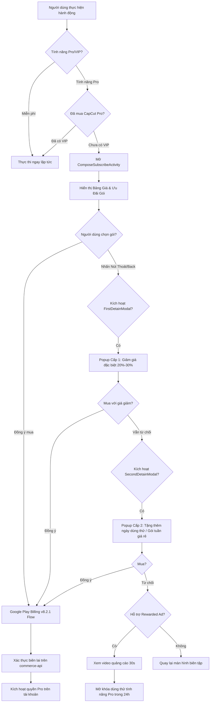

# BÁO CÁO 06: PH N TÍCH PAYMENT WALL, KỊCH BẢN GÓI SUBSCRIPTION VÀ ADS MEDIATION

> **Mục tiêu đáp ứng**: Yêu cầu 14 (Phân tích payment wall kịch bản các gói sub: map purchase, ads).  
> **Phân hệ thực thi trong code**: `com.lemon.clipmonetize.biz.commerce_page.lv_oversea` & `com.vega.subscription`.  
> **Cổng thanh toán chính**: Google Play Billing v8.2.1 (`com.android.billingclient.api.ProxyBillingActivity`).

---

## 1. KIẾN TRÚC PH N HỆ MONETIZATION & PAYMENT WALL

Hệ thống kiếm tiền của CapCut được xây dựng như một cỗ máy tối ưu hóa doanh thu tự động (Revenue Engine) với 3 trụ cột:
1. **Giao diện Paywall Khai báo Hiện đại**: Viết hoàn toàn bằng **Jetpack Compose** (`ComposeSubscribeActivity` & `SubscribePageViewKt`), cho phép render động các khối thẻ sản phẩm, bảng so sánh tính năng Free vs Pro, và banner khuyến mãi từ server.
2. **Chiến Lược Giữ Chân Người Dùng Đa Tầng (Multi-Stage Detain Strategy)**: Tự động phát hiện hành vi muốn thoát của người dùng để tung ra các ưu đãi giảm giá kích cầu tức thì.
3. **Cơ Chế Mở Khóa Tạm Thời Qua Quảng Cáo Thưởng (Rewarded Ads Unlock)**: Cho phép người dùng chưa có điều kiện trả phí được trải nghiệm tính năng VIP trong 24 giờ bằng cách xem video quảng cáo.



---

## 2. BẢNG DANH MỤC GÓI SUBSCRIPTION VÀ ÁNH XẠ MUA HÀNG (SKU MAPPING)

CapCut phân chia thành 2 phân khúc khách hàng chính: **Cá nhân (Individual)** và **Đội ngũ (Teams / Doanh nghiệp)**:

| Nhóm khách hàng | Mã SKU / Tên gói | Chu kỳ gia hạn | Cơ chế khuyến mãi & Dùng thử | Quyền lợi mở khóa (VIP Benefits) |
|---|---|---|---|---|
| **Cá nhân** | `capcut_pro_monthly` | Hàng tháng (Auto-renew) | Dùng thử miễn phí 7 ngày (`VipFTBannerData`) đối với tài khoản mới | Mở khóa toàn bộ hiệu ứng, bộ lọc, font chữ Pro; xuất video 4K 60fps; xóa logo CapCut; 100GB lưu trữ đám mây |
| **Cá nhân** | `capcut_pro_annual` | Hàng năm (Auto-renew) | Tiết kiệm 35% - 40% so với trả hàng tháng; thanh toán 1 lần cho 12 tháng | Toàn bộ quyền lợi gói tháng + ưu tiên kết xuất đám mây tốc độ cao |
| **Cá nhân** | `capcut_pro_weekly_retain` | Hàng tuần (Auto-renew) | **Gói ẩn**: Chỉ xuất hiện trong popup giữ chân (`WeeklyRetainDialogConfig`) khi người dùng từ chối gói tháng | Trải nghiệm Pro trọn vẹn trong 7 ngày với chi phí siêu rẻ |
| **Cá nhân** | `capcut_pro_student` | Hàng tháng / năm | Giảm giá 50% (`VipCheckoutStudentDiscountConfig`) sau khi xác thực email trường học (`.edu`) | Toàn bộ quyền lợi CapCut Pro cho học sinh/sinh viên |
| **Đội nhóm (Teams)** | `capcut_teams_seat_monthly` | Hàng tháng theo số ghế (Seat-based) | Dùng thử 14 ngày cho nhóm từ 2 đến 10 thành viên | Bản nháp chia sẻ dùng chung (Shared Cloud Projects); quản lý quyền admin/editor; không gian mây 1TB |
| **Đám mây (Cloud)** | `capcut_cloud_100gb` | Hàng tháng | Gói mua thêm dung lượng độc lập (`CloudPlanItem`) | Mở rộng thêm 100GB dung lượng lưu trữ bản nháp trên mây |
| **Đám mây (Cloud)** | `capcut_cloud_1tb` | Hàng tháng / năm | Gói mua thêm dung lượng lớn cho nhà sáng tạo nội dung chuyên nghiệp | Mở rộng 1TB lưu trữ bản nháp và video gốc 4K |

---

## 3. KỊCH BẢN KÍCH HOẠT PAYMENT WALL (PAYWALL TRIGGERS)

Hệ thống định vị người dùng và kích hoạt Paywall tại 5 điểm chạm (touchpoints) chiến lược:

1. **Điểm chạm 1: Chạm vào tài nguyên Pro trong lúc biên tập**:
   - Khi người dùng chọn bất kỳ hiệu ứng (Effect), chuyển cảnh (Transition), font chữ nghệ thuật hoặc âm thanh có gắn nhãn biểu tượng **`PRO`**.
   - Ứng dụng vẫn cho phép người dùng áp dụng thử lên video để thấy độ đẹp mắt, nhưng khi nhấn dấu Tick áp dụng hoặc lưu lại, popup mua hàng sẽ lập tức hiển thị.
2. **Điểm chạm 2: Màn hình Xuất Video (Export Gate)**:
   - Nếu dự án có chứa dù chỉ 1 thành phần Pro, hoặc người dùng chọn thiết lập xuất:
     - Độ phân giải: 2K / 4K Ultra HD.
     - Tốc độ khung hình: 60fps.
     - Định dạng màu: Smart HDR (High Dynamic Range).
     - Công nghệ làm nét: AI Video Enhancer.
   - Nút "Xuất" sẽ đổi thành "Nâng cấp Pro để xuất không watermark".
3. **Điểm chạm 3: Hết Hạn Mức Tín Dụng AI Agent (AI Credit Deduction Gate)**:
   - Phân hệ AI Video Agent cấp cho mỗi tài khoản miễn phí một lượng credit nhất định mỗi ngày (thường là 5 lượt sinh video/kịch bản).
   - Khi gọi `/storyboard_agent/v1/ai_lab/get_remain_free_credit` và nhận giá trị `0`, hệ thống kích hoạt `AILabCreditDeductionConfigSettings` mở Paywall nạp thêm credit hoặc mua gói Pro không giới hạn.
4. **Điểm chạm 4: Tràn Dung Lượng Lưu Trữ Đám Mây (Cloud Quota Exceeded)**:
   - Khi dung lượng bản nháp vượt quá mức 10GB miễn phí, kích hoạt `CloudSpaceTipKt` yêu cầu nâng cấp gói lưu trữ đám mây.
5. **Điểm chạm 5: Banner Khuyến Mãi Trên Trang Chủ**:
   - Banner động trên Tab Chỉnh sửa và huy hiệu trên Tab Cá nhân liên tục chạy chiến dịch khuyến mãi theo mùa (Black Friday, New Year Sale, Back to School).

---

## 4. CHIẾN THUẬT GIỮ CH N ĐA TẦNG (DETAIN / RETENTION STRATEGY)

Trong code `com.lemon.clipmonetize.biz.commerce_page.lv_oversea.data`, ByteDance xây dựng hệ thống máy trạng thái giữ chân cực kỳ bài bản:

```
[Người dùng nhấn nút X (Close) trên Paywall]
              │
              ▼
    [Kiểm tra điều kiện Detain]
              │
       ┌──────┴──────┐
       ▼             ▼
[Lần đầu thoát]    [Lần hai thoát]
       │             │
       ▼             ▼
FirstDetainModal   SecondDetainModal
(Giảm ngay 25%)    (Tặng thêm 3 ngày Free Trial)
       │             │
       └──────┬──────┘
              ▼
  [Nếu vẫn kiên quyết thoát]
              │
              ▼
[Hiển thị Toast: RewardAdExpiredToast]
"Xem 1 video quảng cáo ngắn để dùng tính năng này miễn phí trong 24h"
```

1. **`FirstDetainModalCfg`**: Kích hoạt khi người dùng nhấn nút Back/Close lần đầu. Hiển thị thông điệp khẩn cấp: *"Đừng bỏ lỡ! Ưu đãi độc quyền chỉ dành riêng cho bạn: Giảm ngay 25% cho gói năm, chỉ còn $X/tháng"*.
2. **`SecondDetainModalCfg`**: Nếu người dùng tiếp tục từ chối, popup cấp 2 đề xuất chuyển sang gói dùng thử miễn phí không rủi ro hoặc gói tuần siêu tiết kiệm.
3. **`VisitorAutoRenewExperiment`**: Thử nghiệm A/B tự động điều chỉnh giá niêm yết theo từng quốc gia để tối ưu tỷ lệ chuyển đổi (Conversion Rate).

---

## 5. MÔ HÌNH QUẢNG CÁO & XEM ADS ĐỔI TÍNH NĂNG PRO (ADS MEDIATION)

Đối với hơn 80% người dùng không có khả năng chi trả gói VIP, CapCut áp dụng chiến lược kiếm tiền hỗn hợp (Hybrid Monetization):

1. **Quảng cáo Xen kẽ (Interstitial Ads)**: Hiển thị sau khi người dùng xuất video thành công và lưu vào thư viện máy tính/điện thoại.
2. **Quảng cáo Video có Thưởng (Rewarded Video Ads)**:
   - Được điều phối qua `com.vega.adapi.api.IRewardAdApi`.
   - Khi người dùng muốn dùng một hiệu ứng Pro nhưng không muốn mua gói VIP, ứng dụng cho phép xem 1 đoạn video quảng cáo 30 giây từ AdMob/Pangle/Mintegral.
   - Sau khi callback `onUserEarnedReward()` được kích hoạt, hệ thống cấp một token tạm thời có thời hạn 24 giờ cho phép sử dụng hiệu ứng đó mà không bị chặn khi xuất video.
