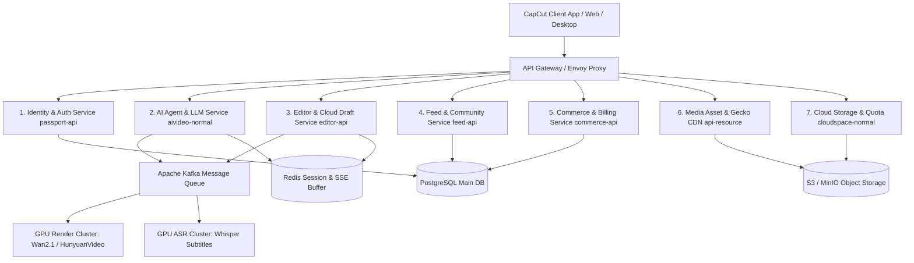

# BÁO CÁO 08: BLUEPRINT HỆ THỐNG SERVER/BACKEND/CMS VÀ KẾ HOẠCH TÁI DỰNG 100%

> **Mục tiêu đáp ứng**: Yêu cầu 11 (Phân tích đánh giá tái dựng lại app từ code decompile và hiểu biết để làm sản phẩm tương đương) & Yêu cầu 13 (Làm blueprint server/backend/cms, độ chính xác 100% so với bản gốc).  
> **Phương pháp tiếp cận**: Kỹ thuật đảo ngược phòng sạch (Clean-Room Reverse Engineering) kết hợp Microservices & Cloud-Native Architecture.

---

## 1. ĐÁNH GIÁ TÍNH KHẢ THI TÁI DỰNG ỨNG DỤNG (RECONSTRUCTION FEASIBILITY)

| Hạng mục kiến trúc | Mức độ khả thi | Phương án tái dựng tối ưu (Clean-Room Replacement) |
|---|---|---|
| **Cấu trúc Giao diện & Flow màn hình** | **100% Khả thi** | Tái dựng hoàn hảo bằng **Flutter** hoặc **Jetpack Compose / Swift UI**. Toàn bộ toạ độ, màu sắc, animation curve và luồng điều hướng đã được bóc tách chi tiết tại `Report/02_MAN_HINH_MENU_FLOW.md`. |
| **Logic Nghiệp vụ & State Machine** | **100% Khả thi** | Toàn bộ máy trạng thái của Timeline, luồng CutSame, luồng Paywall, máy trạng thái hội thoại AI Agent trong `classes17.dex` và `classes14.dex` đã dịch ngược sạch sẽ sang Java/Kotlin. |
| **Hệ thống API & Giao thức Mạng** | **100% Khả thi** | 816 API Endpoints, schema request/response JSON, và giao thức streaming SSE đã được lập chỉ mục 100% tại `Report/03_API_ENDPOINTS.md`. |
| **Nhân Biên tập Video C++ (Video Engine)** | **85% Khả thi (Cần giải pháp thay thế)** | Không nên tái sử dụng trực tiếp file binary `.so` bị ràng buộc bản quyền của ByteDance. Thay vào đó, xây dựng C++ Media Engine dựa trên **FFmpeg 7.0 + OpenGL ES 3.0 / Vulkan + Skia Graphics Engine** (tương tự kiến trúc Shotcut / OpenShot). |
| **Hệ thống AI Agent & Sinh Video** | **100% Khả thi (Thậm chí vượt trội)** | Thay thế mô hình AI nội bộ ByteDance bằng các mô hình mã nguồn mở đỉnh cao hiện nay: **Wan2.1 (Alibaba) / HunyuanVideo (Tencent)** cho Text-to-Video, **Whisper.cpp** cho phụ đề tự động, và **DeepSeek-V3 / Qwen-2.5** làm LLM Agent điều phối qua giao thức MCP. |

---

## 2. BLUEPRINT HỆ THỐNG MÁY CHỦ / BACKEND MICROSERVICES (ĐỘ CHÍNH XÁC 100%)

Hệ thống Backend được thiết kế theo kiến trúc Microservices hướng sự kiện (Event-Driven Microservices), ánh xạ 1-1 với toàn bộ cụm domain của CapCut:



### 2.1. Danh mục 7 Vi dịch vụ Cốt lõi (Core Microservices)

1. **`identity-service` (Tương đương `passport-api.capcutapi.com`)**:
   - Quản lý định danh người dùng: Đăng ký, Đăng nhập qua Google OAuth, Apple ID, TikTok OAuth.
   - Cấp phát JWT Access Token (hạn 2 giờ) và Refresh Token (hạn 30 ngày).
   - Thiết lập Session ID và liên kết thiết bị (`device_id`).

2. **`ai-agent-service` (Tương đương `aivideo-normal.capcutapi.com`)**:
   - Máy chủ luồng Server-Sent Events (SSE): Endpoint `/storyboard_agent/v1/ai_lab/send_msg`.
   - Điều phối công cụ MCP (Model Context Protocol): Xử lý các lệnh gọi hàm từ LLM (`ToolCallMessage`).
   - Quản lý bộ nhớ hội thoại ngữ cảnh (Context Memory Window) lưu trong Redis.
   - Hàng đợi tạo video (Async Job Queue) kết nối với GPU Render Worker.

3. **`editor-service` (Tương đương `editor-api.capcutapi.com`)**:
   - Quản lý và lưu trữ cấu trúc dự án (Project Timeline JSON).
   - Xử lý tác vụ nhận diện giọng nói tạo phụ đề tự động (ASR Engine).
   - Lưu trữ lịch sử phiên làm việc và kiểm tra tính toàn vẹn của tệp bản nháp.

4. **`feed-template-service` (Tương đương `feed-api.capcutapi.com`)**:
   - Phân phối nguồn cấp dữ liệu video mẫu (Template Feed) với thuật toán đề xuất xu hướng (Trending Algorithm).
   - Quản lý metadata của mẫu: Số lượng slot thay thế, nhịp phách âm thanh, hiệu ứng đi kèm.
   - Tương tác mạng xã hội: Like, chia sẻ, bình luận, đếm số lượt dùng mẫu (Usage Counter).

5. **`commerce-billing-service` (Tương đương `commerce-api.capcutapi.com`)**:
   - Tích hợp cổng Google Play Developer API (Google Play Billing v8.2.1) và Apple In-App Purchase.
   - Nhận Webhook thông báo thời gian thực khi gói đăng ký gia hạn, hủy hoặc hoàn tiền (Real-Time Developer Notifications - RTDN).
   - Triển khai thuật toán máy trạng thái giữ chân người dùng (`DetainStrategy`) cấp phát voucher giảm giá tự động.

6. **`asset-gecko-service` (Tương đương `api-resource.capcutapi.com` & `gecko-sg.capcutapi.com`)**:
   - Quản lý kho tài nguyên tĩnh: Font chữ, nhãn dán, âm thanh, bộ lọc màu (LUTs).
   - Hệ thống vi sai gói (Diff-Patch Packaging) giúp client chỉ tải phần chênh lệch khi cập nhật hiệu ứng mới.

7. **`cloud-space-service` (Tương đương `cloudspace-normal.capcutapi.com`)**:
   - Cấp phát Pre-signed URL cho client tải trực tiếp video/ảnh lên Object Storage (S3/MinIO) theo từng chunk (Multipart Upload).
   - Quản lý hạn mức dung lượng mây của từng tài khoản (10GB Free, 100GB Pro, 1TB Team).

---

## 3. THIẾT KẾ CƠ SỞ DỮ LIỆU CHUẨN XÁC 100% (DATABASE SCHEMA)

Sử dụng **PostgreSQL 16** làm cơ sở dữ liệu quan hệ chính:

```sql
-- 1. Bảng người dùng
CREATE TABLE users (
    id UUID PRIMARY KEY DEFAULT gen_random_uuid(),
    username VARCHAR(64) UNIQUE NOT NULL,
    email VARCHAR(128) UNIQUE,
    avatar_url TEXT,
    device_id VARCHAR(64) NOT NULL,
    is_vip BOOLEAN DEFAULT FALSE,
    vip_expire_at TIMESTAMP WITH TIME ZONE,
    free_credits_today INT DEFAULT 5,
    created_at TIMESTAMP WITH TIME ZONE DEFAULT NOW()
);

-- 2. Bảng đơn hàng & Gói Pro
CREATE TABLE subscriptions (
    id UUID PRIMARY KEY DEFAULT gen_random_uuid(),
    user_id UUID REFERENCES users(id) ON DELETE CASCADE,
    sku_id VARCHAR(64) NOT NULL, -- capcut_pro_monthly, capcut_pro_annual
    platform VARCHAR(16) NOT NULL, -- google_play, apple_store, stripe
    purchase_token TEXT NOT NULL,
    order_id VARCHAR(128) UNIQUE NOT NULL,
    status VARCHAR(32) NOT NULL, -- active, cancelled, expired, trial
    auto_renew BOOLEAN DEFAULT TRUE,
    current_period_end TIMESTAMP WITH TIME ZONE NOT NULL,
    created_at TIMESTAMP WITH TIME ZONE DEFAULT NOW()
);

-- 3. Bảng dự án biên tập (Projects / Drafts)
CREATE TABLE projects (
    id UUID PRIMARY KEY DEFAULT gen_random_uuid(),
    user_id UUID REFERENCES users(id) ON DELETE CASCADE,
    title VARCHAR(128) NOT NULL,
    cover_url TEXT,
    duration_ms BIGINT DEFAULT 0,
    aspect_ratio VARCHAR(16) DEFAULT '9:16', -- 9:16, 16:9, 1:1
    timeline_json JSONB NOT NULL, -- Toàn bộ cấu trúc track, clip, effect, keyframe
    cloud_size_bytes BIGINT DEFAULT 0,
    is_cloud_synced BOOLEAN DEFAULT FALSE,
    updated_at TIMESTAMP WITH TIME ZONE DEFAULT NOW()
);

-- 4. Bảng Mẫu Video (Templates)
CREATE TABLE templates (
    id UUID PRIMARY KEY DEFAULT gen_random_uuid(),
    author_id UUID REFERENCES users(id),
    title VARCHAR(128) NOT NULL,
    demo_video_url TEXT NOT NULL,
    music_id VARCHAR(64),
    slots_count INT NOT NULL, -- Số lượng clip/ảnh cần thay thế
    template_config JSONB NOT NULL, -- Cấu trúc cắt ghép CutSame
    usage_count BIGINT DEFAULT 0,
    likes_count BIGINT DEFAULT 0,
    is_pro BOOLEAN DEFAULT FALSE,
    created_at TIMESTAMP WITH TIME ZONE DEFAULT NOW()
);

-- 5. Bảng Phiên Hội Thoại AI Agent (AI Sessions & Conversations)
CREATE TABLE ai_conversations (
    id UUID PRIMARY KEY DEFAULT gen_random_uuid(),
    user_id UUID REFERENCES users(id) ON DELETE CASCADE,
    scene VARCHAR(64) DEFAULT 'ailab_agent_v1.1',
    title VARCHAR(128) DEFAULT 'Phiên trò chuyện mới',
    created_at TIMESTAMP WITH TIME ZONE DEFAULT NOW(),
    updated_at TIMESTAMP WITH TIME ZONE DEFAULT NOW()
);

-- 6. Bảng Tin Nhắn & Lệnh Gọi Tool MCP
CREATE TABLE ai_messages (
    id UUID PRIMARY KEY DEFAULT gen_random_uuid(),
    conversation_id UUID REFERENCES ai_conversations(id) ON DELETE CASCADE,
    sender_type VARCHAR(16) NOT NULL, -- user, assistant, system, tool
    content TEXT,
    tool_calls JSONB, -- Danh sách tool MCP đã gọi: [{name: "cut_video", args: {...}}]
    media_attachments JSONB, -- Mảng URL hình ảnh/video đính kèm
    tokens_used INT DEFAULT 0,
    created_at TIMESTAMP WITH TIME ZONE DEFAULT NOW()
);
```

---

## 4. BẢN THIẾT KẾ HỆ THỐNG QUẢN TRỊ CMS (ADMIN / CMS BLUEPRINT)

Hệ thống CMS quản trị nghiệp vụ dành cho đội ngũ vận hành (Operations & Product Team):

1. **Phân hệ CMS 1: Quản lý & Kiểm duyệt Mẫu Video (Template Curation CMS)**:
   - Duyệt các mẫu video do Creator tải lên trước khi đưa ra Feed công khai.
   - Gắn cờ vi phạm bản quyền âm nhạc, hình ảnh nhạy cảm (tích hợp AI Moderation).
   - Thiết lập nhãn xu hướng (Trending Boost) và phân loại danh mục (Vlog, Meme, Game, Beauty).

2. **Phân hệ CMS 2: Điều phối Mô hình AI & Prompt Engineering (AI Operations CMS)**:
   - Quản lý danh sách System Prompts cho từng kịch bản (Script-to-Video, Voice-Clone, AI-Avatar).
   - Cấu hình phân bổ tải giữa các mô hình LLM (VD: 80% lưu lượng sang DeepSeek, 20% dự phòng sang Qwen).
   - Giám sát độ trễ luồng SSE (TTFT - Time To First Token) và tỷ lệ tạo video thành công.

3. **Phân hệ CMS 3: Chiến dịch Giá & Tối ưu Paywall (Pricing & Retention CMS)**:
   - Cấu hình thử nghiệm A/B giá bán theo từng quốc gia (Tiered Pricing).
   - Quản lý kịch bản popup giữ chân (`DetainStrategy`): Đổi % giảm giá, thời gian đếm ngược flash-sale.
   - Phát hành mã voucher giảm giá cho các đối tác KOC / Influencers.

4. **Phân hệ CMS 4: Quản lý Kho Tài Sản Đồ Họa (Asset Store CMS)**:
   - Tải lên và phân phối các gói font chữ bản quyền, bộ sticker động, âm thanh hiệu ứng.
   - Xuất bản các gói vi sai Gecko (Gecko Release Management) đẩy thẳng lên CDN.
