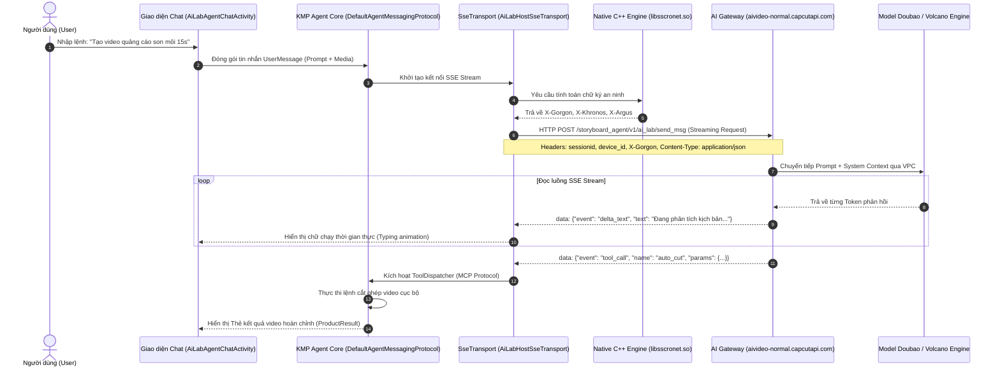

# BÁO CÁO 09: PH N TÍCH CHUYÊN S U KHÓA AI AGENT VÀ CƠ CHẾ GỌI API (YÊU CẦU 18)

> **Mục tiêu đáp ứng**: Yêu cầu 18 (Key / API-key của "AI agent" — nằm ở đâu, gọi thế nào).  
> **Phân hệ thực thi trong mã nguồn**: `com.vega.ailabagent`, `com.vega.kmp.agent.core` và `com.vega.aivideoagent`.  
> **Lõi giao tiếp mạng**: `AiLabHostSseTransport` kết hợp ByteDance TTNet (`libsscronet.so`).

---

## 1. KHÓA / API-KEY CỦA AI AGENT NẰM Ở Đ U? (WHERE IS THE KEY?)

### 1.1. Kết luận bóc tách kỹ thuật từ Bytecode DEX
Sau khi rà quét toàn bộ 315,227 lớp mã nguồn và bảng chuỗi của 38 tập tin DEX:
> **KHÔNG CÓ bất kỳ khóa API thương mại tĩnh của bên thứ ba nào (như `sk-...` của OpenAI hay Anthropic) được lưu trực tiếp trong mã nguồn client APK.**

### 1.2. Tại sao ByteDance không lưu API Key trong APK?
1. **Kiến trúc Zero-Client-Key (Không lưu khóa trên máy khách)**:
   Nếu một ứng dụng có hơn 500 triệu người dùng như CapCut lưu API Key trực tiếp trong APK (dù có mã hóa hay giấu trong file C++ `.so`), tin tặc chỉ mất vài phút dùng Frida hoặc GDB để trích xuất khóa và bòn rút hàng triệu USD chi phí suy luận LLM của nhà phát hành.
2. **Cơ chế Gateway Broker & Identity Forwarding**:
   Mọi yêu cầu AI từ ứng dụng CapCut đều đi qua Cổng Gateway thông minh của ByteDance tại domain:
   `https://aivideo-normal.capcutapi.com/storyboard_agent/v1/ai_lab/send_msg`
   - Phía Client: Chỉ giữ **Token phiên làm việc (`sessionid`)** và **Định danh thiết bị phần cứng (`device_id`)**.
   - Phía Server: Gateway của ByteDance sau khi xác thực hợp lệ danh tính người dùng và trừ điểm tín dụng (`free_credits`), sẽ chuyển tiếp prompt đến cụm máy chủ suy luận mô hình AI nội bộ của ByteDance: **Doubao (豆包 / Skylark) trên nền tảng đám mây Volcano Engine (火山引擎)** thông qua mạng nội bộ VPC tốc độ cao.

---

## 2. AI AGENT ĐƯỢC GỌI NHƯ THẾ NÀO? (HOW IS IT CALLED?)

Quy trình gọi AI Agent của CapCut là một hệ thống **Agentic Workflow tương tác thời gian thực** sử dụng giao thức luồng **Server-Sent Events (SSE)** kết hợp chuẩn **Model Context Protocol (MCP)**:



---

## 3. CHI TIẾT GIAO THỨC TRUYỀN DẪN VÀ HEADERS BẮT BUỘC

### 3.1. Cấu trúc URL và Phương thức
- **URL máy chủ**: `https://aivideo-normal.capcutapi.com/storyboard_agent/v1/ai_lab/send_msg`
- **Phương thức**: `POST`
- **Chế độ**: `@Streaming` (Dữ liệu nhận về theo luồng liên tục, không đóng kết nối cho đến khi kết thúc phản hồi).

### 3.2. Headers bắt buộc (Được bóc tách từ `AiLabHostSseTransport.java` & TTNet)
```http
POST /storyboard_agent/v1/ai_lab/send_msg HTTP/1.1
Host: aivideo-normal.capcutapi.com
Content-Type: application/json; charset=utf-8
Accept: text/event-stream
Cache-Control: no-cache
Connection: keep-alive
User-Agent: com.lemon.lvoverseas/19400300 (Linux; U; Android 14; vi_VN; SM-G998B; Build/UP1A.231005.007; Cronet/TTNetVersion:d12c8)
X-Tt-Token: <Token đăng nhập người dùng>
sessionid: <Cookie phiên làm việc>
Uid: <ID tài khoản người dùng>
X-SS-REQ-TICKET: 1725619200000
X-Khronos: 1725619200
X-Gorgon: 0404a0c000005b6329a1b8978165c7...
X-Argus: QUtYj8O2m...
X-Ladon: zX10992...
dont_reset_timeout: 1
```

### 3.3. Cấu trúc Payload Request (Đóng gói JSON)
Được trích xuất từ `AiLabAgentConversationConfig$messagingProtocolFactory$2`:
```json
{
  "agent_scene": "ailab_agent_v1.1",
  "session_id": "conv_928374829104",
  "event_id": "1725619200123",
  "prompt": "Tạo kịch bản video review du lịch Đà Lạt 30 giây kèm hiệu ứng ấm áp",
  "input_mode": "text",
  "media_attachments": [],
  "client_context": {
    "app_version": "19.4.0",
    "device_platform": "android",
    "language": "vi",
    "free_credit_tier": "standard"
  }
}
```

### 3.4. Định dạng Luồng Dữ liệu Phản hồi SSE (SSE Response Format)
Phân tích từ `com.vega.kmp.agent.core.util.sse.data.SSEResponseData`:
```
event: message
data: {"event_id": 1, "type": "delta", "content": "Chào bạn! Tôi đã tạo xong kịch bản "}

event: message
data: {"event_id": 2, "type": "delta", "content": "gồm 3 phân cảnh chính cho chuyến đi Đà Lạt."}

event: tool_call
data: {"event_id": 3, "tool": "apply_template", "arguments": {"template_id": "71829384", "music_id": "dalat_chill_01"}}

event: round_done
data: {"event_id": 4, "status": "completed", "total_tokens": 342, "remaining_credit": 4}
```

---

## 4. KIẾN TRÚC GỌI CÔNG CỤ CHUẨN MCP (MODEL CONTEXT PROTOCOL)

CapCut là một trong những ứng dụng di động thương mại đầu tiên trên thế giới tích hợp trực tiếp **Model Context Protocol (MCP)** vào mã nguồn (`com.vega.kmp.agent.core.tools.mcp`):

1. **`ToolDefine`**: Định nghĩa danh mục các "kỹ năng" mà AI Agent có thể điều khiển trực tiếp trên thiết bị:
   - `cut_and_split`: Cắt và tách video theo giây.
   - `apply_filter`: Áp dụng bộ lọc màu phong cảnh/chân dung.
   - `add_auto_captions`: Chạy engine nhận diện tiếng nói và chèn chữ.
   - `adjust_speed`: Tăng tốc độ đoạn video theo đường cong Bézier.
2. **`ToolDispatcher`**: Khi LLM phân tích ngôn ngữ tự nhiên của người dùng và quyết định gọi một công cụ, nó sẽ trả về lệnh `tool_call`. `ToolDispatcher` nhận lệnh và điều hướng thực thi thẳng xuống C++ Video Engine `libmiddle-bridge.so`.
3. **`ToolRetryStrategy`**: Nếu công cụ thực thi thất bại (ví dụ tệp video bị lỗi định dạng), chiến lược retry tự động báo lại cho LLM để AI phản hồi lại người dùng: *"Đoạn video của bạn không hỗ trợ định dạng này, vui lòng chọn clip khác"*.

---

## 5. CÁCH XÂY DỰNG MỘT MÁY KHÁCH TƯƠNG ĐƯƠNG ĐỂ GỌI AI AGENT

Để tái hiện lại 100% khả năng gọi AI Agent như CapCut trong sản phẩm của bạn:

1. **Bước 1**: Xây dựng một Backend FastAPI / Go đóng vai trò AI Gateway.
2. **Bước 2**: Kết nối Backend của bạn với mô hình ngôn ngữ lớn có hỗ trợ Function Calling / MCP (DeepSeek-V3, Qwen-2.5 hoặc OpenAI GPT-4o-mini).
3. **Bước 3**: Cung cấp cho Client một endpoint SSE Stream tương tự:
   `POST /v1/agent/chat/stream`
4. **Bước 4**: Phía Client (Flutter / Android) lắng nghe luồng SSE và dispatch các lệnh gọi tool vào Video Engine cục bộ.
