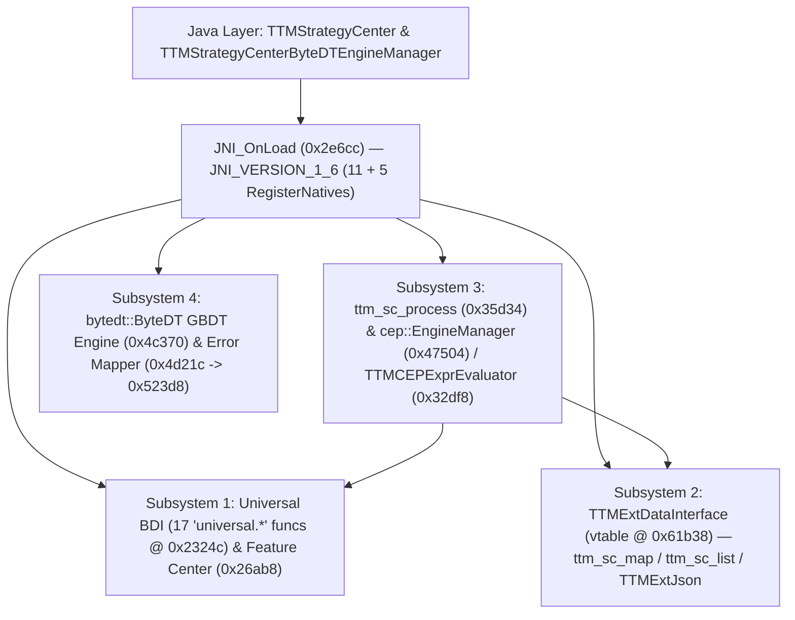

# TÓM TẮT KIẾN TRÚC NATIVE: `libTTMStrategyCenter.so` (ARCHITECTURAL SUMMARY)

## 1. Tổng quan Hệ thống (System Overview)
- **Thư viện**: `libTTMStrategyCenter.so` (`395,664 bytes`, ARM64-v8a ELF64)
- **Vai trò trong NextAI OpenCut**: Trung tâm Chiến lược Thông minh Thời gian thực (Real-time Strategy Center), kết hợp 3 động cơ suy luận trên thiết bị:
  1. **TTM Machine Bytecode Rule Engine**: Đánh giá cây biểu thức chiến lược được biên dịch thành bytecode thông qua `ttm_sc_process` (`0x35d34`) và `libTTMachineCore.so`.
  2. **CEP (Complex Event Processing) Stream Engine**: Xử lý luồng sự kiện phức hợp theo thời gian thực qua `cep::EngineManager` (`0x47504`) và `cep::TTMCEPExprEvaluator` (`0x32df8`), kết nối xuống `libCepEngine.so`.
  3. **ByteDT Gradient Boosted Decision Tree (GBDT) Engine**: Suy luận cây quyết định tăng cường độ dốc (`bytedt::ByteDT` @ `0x4c370`) với cơ chế duyệt cây nhị phân, tính tổng margin thô (`predict_raw` @ `0x4cf68`), biến đổi Sigmoid/Softmax (`predict` @ `0x4ce24`), và trích xuất chỉ số nút lá (`predict_leaf` @ `0x4d174`).

## 2. Sơ đồ Luồng Kiến trúc (Mermaid Architecture Flowchart)

## 3. Điểm nhấn Toán học & Hợp ngữ AArch64 (`OBSERVED`)
- **Chia nhanh cho 40 (`sizeof(std::any) == 40`) trong `ttm_sc_list::make_real_index` (`0x41fa0`)**:
  - Sử dụng phép dịch phải 3 bit (`asr x8, x8, #3`) kết hợp nhân với nghịch đảo nhân modulo $2^{64}$ của $5$ là `0xcccccccccccccccdULL` (`mov x9, #-0x3333333333333334; movk x9, #0xcccd; mul x8, x8, x9`), cho phép tính chính xác số phần tử `std::vector<std::any>` trong 4 chu kỳ lệnh mà không dùng lệnh chia `udiv`.
- **Bảng ánh xạ mã lỗi ByteDT trong `transformByteDtErrorToTTMErrorCode` (`0x4d21c`)**:
  - Kiểm tra biên không dấu `and w8, w0, #0xff; cmp w8, #6; b.hi #0x4d23c`, tra bảng `.rodata` tại `0x523d8` (`[0, 401, 402, 403, 404, 405, 406]`) và trả về mặc định `407` (`0x197`) khi vượt biên.
