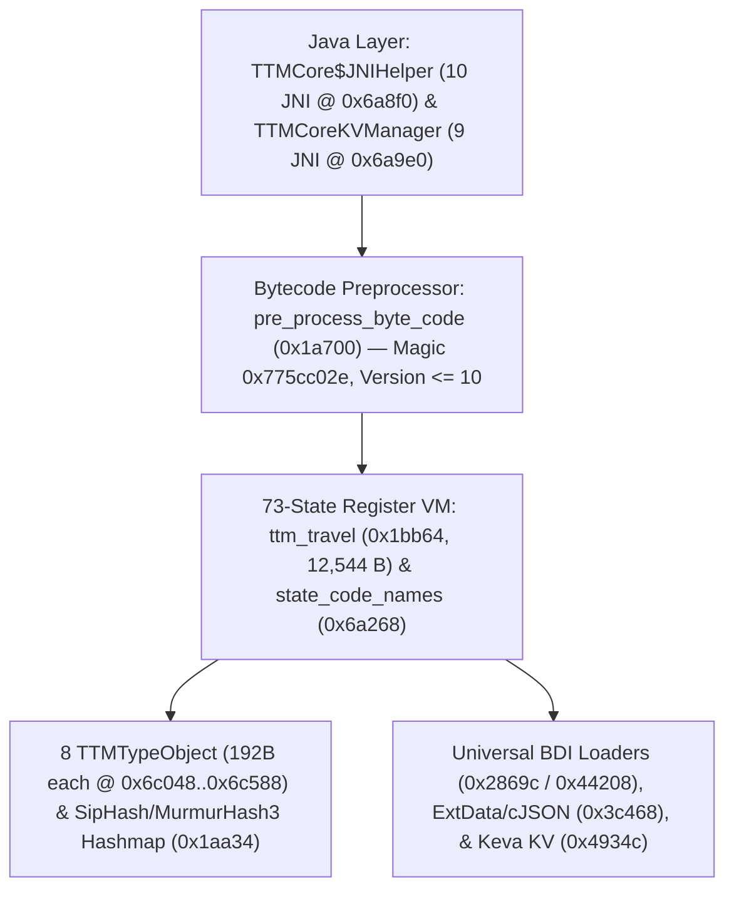

# TÓM TẮT KIẾN TRÚC NATIVE: `libTTMachineCore.so` (ARCHITECTURAL SUMMARY)

## 1. Tổng quan Hệ thống (System Overview)
- **Thư viện**: `libTTMachineCore.so` (`429,872 bytes`, ARM64-v8a ELF64)
- **Vai trò trong NextAI OpenCut**: Máy ảo Thực thi Bytecode Thanh ghi 73 Trạng thái (73-State Register-Based Bytecode Virtual Machine) cho toàn bộ quy tắc chiến lược thời gian thực của hệ sinh thái TikTok/CapCut (`com.tiktok.ttm.TTMCore`).

## 2. Sơ đồ Luồng Kiến trúc (Mermaid Architecture Flowchart)

## 3. Điểm nhấn Toán học & Hợp ngữ AArch64 (`OBSERVED`)
- **Kiểm tra chia hết cho `1000` không dùng phép chia trong `ttm_state_error_code_for_business` (`0x1758c`)**:
  - Vì $1000 = 8 \times 125$ và $125 \times \text{0x26e978d5} \equiv 1 \pmod{2^{32}}$, mã máy nhân `w0` với `0x26e978d5`, xoay phải 3 bit (`extr w8, w8, w8, #3`) và so sánh với $\lfloor 2^{32} / 1000 \rfloor + 1 = \text{0x00418938}$ (`ccmp w8, w10, #2, lo`) để xác minh đồng thời `base_code % 1000 == 0` và `1 <= sub_code <= 1000`.
- **Xác thực Header Bytecode trong `pre_process_byte_code` (`0x1a700`)**:
  - Đọc 4 byte đầu so khớp hằng số ma thuật `0x775cc02e` (`mov w9, #0xc02e; movk w9, #0x775c, lsl #16`) và đọc 2 byte phiên bản tại offset `+4` so sánh với `10` (`ttm_support_max_bytecode_version` @ `0x17244`).
