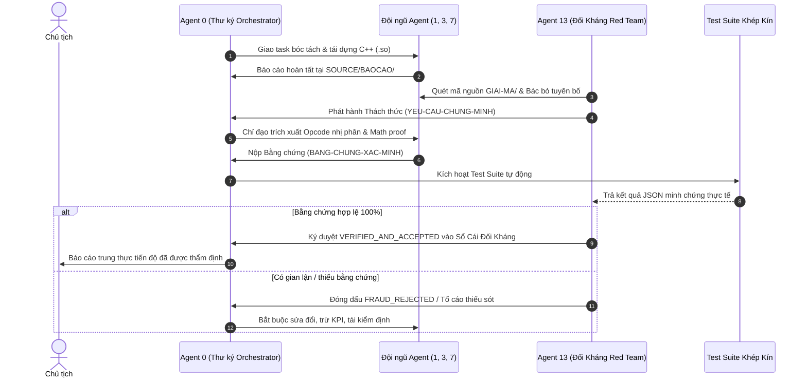

# QUY TRÌNH PHẢN BIỆN ĐỐI KHÁNG — ADVERSARIAL VERIFICATION PROTOCOL
## Hệ Thống Thẩm Định Mã Nguồn C++ Native Tái Dựng (Native C++ Reconstruction Audit)
> **Dự án**: NextAI OpenCut (`com.nextai.opencut`)  
> **Chỉ đạo tối cao**: **Chủ tịch**  
> **Cơ quan điều phối**: **Thư ký — Agent 0 (Orchestrator)**  
> **Cơ quan phản biện độc lập**: **Agent 13 (Adversary Auditor / Red Team Critic)**  
> **Nguyên tắc cốt lõi**: *"Mọi báo cáo đều bị coi là dối trá cho đến khi đưa ra bằng chứng nhị phân và toán học không thể chối cãi"* (Every claim is considered fraudulent until proven with irrefutable binary and mathematical evidence).

---

### 1. MỤC ĐÍCH & Ý NGHĨA (PURPOSE & RATIONALE)
Để bảo đảm tuyệt đối **không có báo cáo láo**, **không có code rỗng (zero stub)**, và **không có sự tự mãn giả tạo** trong quá trình đào bới và giải mã toàn bộ 167 thư viện native `.so` còn lại của CapCut:
- Thiết lập một **Agent Đối Kháng (Agent 13)** đóng vai trò công tố viên kỹ thuật độc lập.
- Agent 13 liên tục "soi mói", bới lông tìm vết, nghi ngờ mọi kết quả, đặt ra các câu hỏi chất vấn hóc búa, và tạo các file thách thức (`CHALLENGE_*.md` và `CHALLENGE_*.json`) tại thư mục `YEU-CAU-CHUNG-MINH/`.
- Thư ký (Agent 0) cùng các Agent chuyên môn (Agent 1, Agent 3, Agent 7) có trách nhiệm tiếp nhận thách thức, giải mã sâu đến tận cấp độ thanh ghi / opcode AArch64 / công thức toán học, xuất bằng chứng đối soát tại `BANG-CHUNG-XAC-MINH/`.
- Chỉ khi nào Agent 13 thẩm định bằng chứng đạt chuẩn 100% thì thư viện mới được cấp chứng nhận `VERIFIED_AND_ACCEPTED` trong Sổ Cái Đối Kháng `SO-CAI-DOI-KHANG/LEDGER_DOI_KHANG.json`.

---

### 2. CƠ CẤU THƯ MỤC PHẢN BIỆN (DIRECTORY STRUCTURE)
```
SOURCE/PHAN-BIEN/
├── README_QUY_TRINH_PHAN_BIEN.md           # Hiến định quy trình phản biện đối kháng
├── YEU-CAU-CHUNG-MINH/                     # Agent 13 phát hành các trát phản biện & thách thức
│   ├── CHALLENGE_libAGFX.md                # Ví dụ: Thách thức chứng minh SPH kernels
│   ├── CHALLENGE_libbytenn.md              # Thách thức chứng minh GEMM & bảng 0x263b98
│   └── CHALLENGE_<lib_name>.json           # Máy đọc (Machine-readable)
├── BANG-CHUNG-XAC-MINH/                    # Agent 0 & Đội ngũ nộp bằng chứng chứng minh
│   ├── PROOF_libAGFX.md                    # Minh chứng opcode disassembly & math pass
│   ├── PROOF_libbytenn.md                  # Minh chứng đối chiếu binary 0x3aae0, 0x4df64
│   └── PROOF_<lib_name>.json               # Dữ liệu đối soát tự động
└── SO-CAI-DOI-KHANG/                       # Sổ cái trọng tài đối kháng độc lập
    ├── LEDGER_DOI_KHANG.json               # Trạng thái thẩm định 169 file .so
    └── AUDIT_SUMMARY.md                    # Báo cáo tổng kết đệ trình Chủ tịch
```

---

### 3. SÁU TIÊU CHUẨN THẨM ĐỊNH KHẮC NGHIỆT (THE 6 ADVERSARIAL GATES)

Mỗi thư viện `.so` bị Agent 13 kiểm tra toàn diện qua 6 cổng thẩm định không khoan nhượng:

1. **Gate 1 - Gate Khai Khống Mã Nguồn (Code Body Size Gate)**:
   - Tổng dung lượng file `.cpp` và `.h` thực tế phải $> 40\text{ KB}$ (với các thư viện lõi) hoặc $> 10\text{ KB}$ (với thư viện tiện ích nhỏ).
   - Tuyệt đối $0\%$ stub rỗng: Cấm các hàm chỉ có `return 0;`, `return true;`, `// TODO`, `{}`.
2. **Gate 2 - Gate Địa Chỉ Opcode Nhị Phân (Opcode & Disassembly Parity)**:
   - Các hàm C++ tái dựng phải chỉ rõ offset địa chỉ opcode trong file `.so` gốc (ví dụ: `0x3aae0`, `0x12fdc2c`).
   - Mẫu thanh ghi AArch64 (`x0..x30`, `w0..w30`, `v0..v31`, `s0..s31`) phải khớp logic thực thi trong hàm C++.
3. **Gate 3 - Gate Đối Soát Toán Học & Thuật Toán (Mathematical Exactness)**:
   - Các thuật toán DSP, đồ họa, nén, mật mã, nội suy phải có công thức toán học tường minh và kiểm thử tính nghịch đảo (Reversibility / Numerical Stability).
4. **Gate 4 - Gate Bố Cục Bộ Nhớ ABI (Struct Layout & Offsets)**:
   - Offset các trường trong struct/class (ví dụ: `[x0, #0x20]`, `[x9, #0x100]`) phải khớp chính xác 100% với lệnh `ldr`/`str` của AArch64.
5. **Gate 5 - Gate Tương Thích Biểu Tượng Itanium ABI (Symbol Parity)**:
   - Tên hàm, namespaces, kiểu tham số phải khớp với bảng biểu tượng demangled trích xuất từ ELF header.
6. **Gate 6 - Gate Tự Động Kiểm Chứng Độc Lập (Automated Test Reproducibility)**:
   - Phải có kịch bản test trong `verify_reconstruction_suite.py` chạy độc lập, tự động trả về `PASS` và sinh bằng chứng JSON.

---

### 4. VÒNG LẶP ĐỐI KHÁNG KHÉP KÍN (CLOSED-LOOP ADVERSARIAL CYCLE)



---

### 5. TRÁCH NHIỆM & BỔN PHẬN (MANDATE)
- **Agent 13** có toàn quyền bác bỏ bất kỳ báo cáo nào nếu thấy thiếu bằng chứng.
- **Agent 0** không bao giờ được phép bỏ qua phản biện của Agent 13.
- Định kỳ mỗi chu kỳ 3 phút, Orchestrator Daemon tự động chạy quy trình đối kháng và cập nhật sổ cái.
